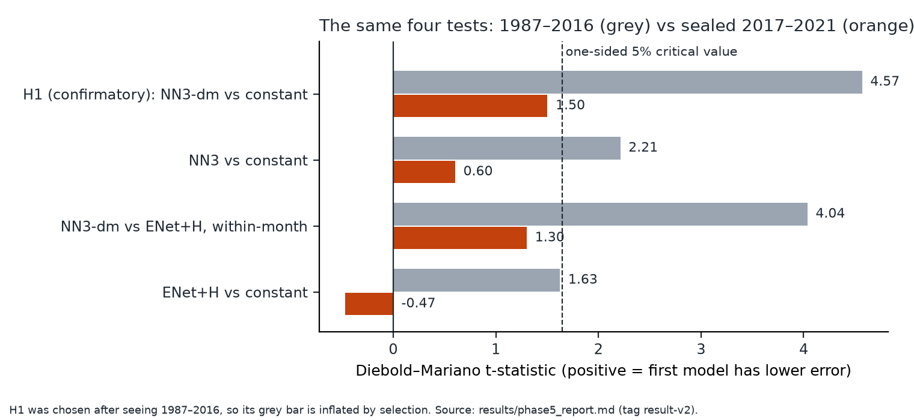

# Machine learning vs a constant: re-testing Gu, Kelly & Xiu (2020)

[](https://github.com/PatrickDamouni/gkx-replication/actions/workflows/tests.yml)
[](LICENSE)

**Question.** Gu, Kelly & Xiu (2020, *Review of Financial Studies*) found that neural networks and
trees forecast next-month US stock returns better than linear models. Does that hold when every
test is fixed in advance and each window of data is looked at only once — including five years,
2017–2021, kept sealed until the end?

**Answer.**
- **1987–2016** (GKX's window, their own 94 stock characteristics): their ranking of models did
  **not** reproduce. Their headline network (NN3, averaged over 5 random seeds) did beat the
  simplest honest benchmark, each training period's average return: out-of-sample R² 0.45% vs
  0.18% (one-sided p = 0.013, not significant after correcting for the 7 pre-specified tests). The
  edge needed the 5-seed average, sat in the smallest stocks, and was concentrated before 2003.
- **2017–2021** (sealed, opened once): the single test fixed and published before unsealing did
  **not detect** an edge (t = 1.50, p = 0.066). With 60 months it had only about 30% power if the
  effect had halved, so this is weak evidence of decay, not proof that the edge is gone.

**Why 0.45% is normal, not broken.** Monthly returns of individual stocks are mostly unpredictable
news; GKX's own headline network scores 0.40%. A value far above 1% would point to look-ahead
leakage. Small R² across thousands of stocks still adds up: in 1987–2016 a portfolio long the top
and short the bottom decile of NN3's forecasts had an annualized Sharpe ratio of 1.43 (95% CI
1.06–1.82), before trading costs.



**Check it without licensed data:**
```bash
git show prereg-v1:PREREGISTRATION.md                    # the plan, tagged before the first results
git diff freeze-v2 result-v2 -- src scripts tests        # empty: the frozen code ran unchanged
grep -c '"name": "[^"]*-holdout"' results/trials.jsonl   # 18: one run per model, all at commit 0541701
```
The test badge runs the 191 tests that need no licensed data on every push.

**Read next:** [`WRITEUP.md`](WRITEUP.md) (10 minutes, both results and what is *not* claimed) ·
[`PREREGISTRATION.md`](PREREGISTRATION.md) · [`DECISIONS.md`](DECISIONS.md) (full audit trail) ·
[`docs/phases.md`](docs/phases.md).

Built with substantial AI assistance (Claude); [`WRITEUP.md`](WRITEUP.md) says what that covered.
Code is MIT-licensed. The data — CRSP via WRDS and GKX's published characteristics — are licensed
separately and are not in this repository.

## Running

```bash
uv sync --frozen
uv run pytest -q -W error \
  --deselect tests/test_feature_map.py::test_every_gkx_characteristic_appears_exactly_once \
  --deselect tests/test_feature_map.py::test_osap_signals_are_published_predictors
GKX_TORCH=1 uv run pytest -q tests/nn    # torch and LightGBM never share a process
```

The two deselected tests read licensed files. Reproducing the models needs WRDS access plus the
original GKX and Welch–Goyal downloads (`cp .env.example .env` and add a WRDS username); the
single-look runbooks are [`docs/freeze_checklist.md`](docs/freeze_checklist.md) (1987–2016) and
D053 in [`DECISIONS.md`](DECISIONS.md) (2017–2021).
