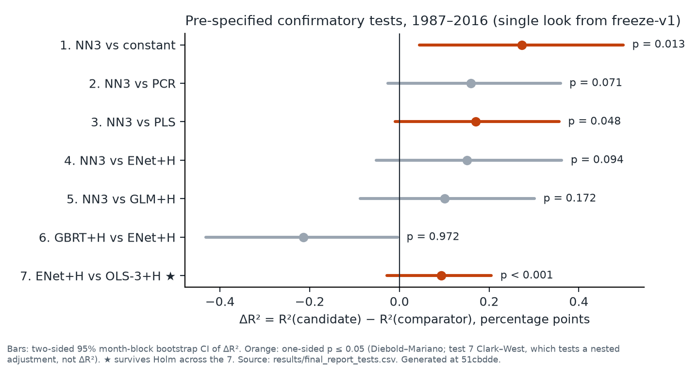
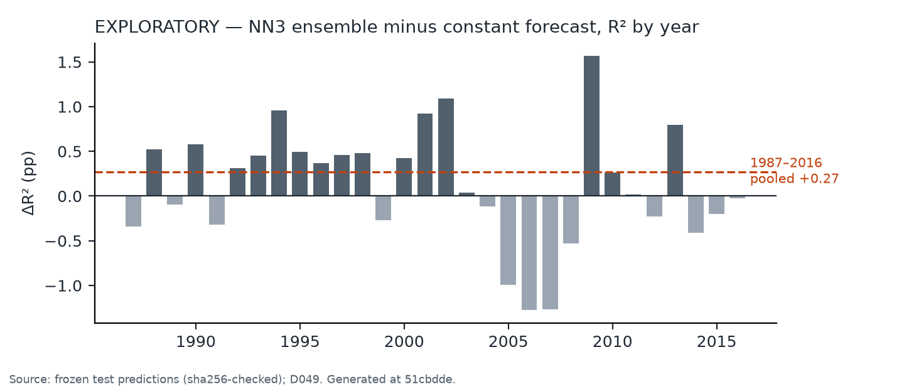

# Machine learning vs a constant: a pre-specified, single-look reproduction of Gu, Kelly & Xiu (2020), 1987–2016, with a sealed 2017–2021 holdout

Patrick Damouni · Michigan State University · October 2026

*AI assistance:* the code, analyses and this text were drafted with Claude (Anthropic) under my
direction, and design reviews were run as panels of Claude instances ("councils"; records in
`.claude/council-cache/`). Every decision was mine to approve. Code, decisions and reports:
https://github.com/PatrickDamouni/gkx-replication (public since 2026-10-12). "Dnnn" refers to an entry in [`DECISIONS.md`](DECISIONS.md).

## The result

1. **GKX's model ranking did not reproduce.** NN3 beats all four linear models in point estimate
   but significantly (one-sided p ≤ 0.05) only PLS (p = 0.048), and none after a Holm correction.
   Gradient-boosted trees did worse than the elastic net (ΔR² −0.21 pp, borderline), partly because
   they fit month-level returns and fell back to a constant in 6 of 30 years.
2. **A 5-seed NN3 ensemble beats a constant forecast** (each training window's mean return):
   ΔR² = +0.27 pp [0.05, 0.50], one-sided p = 0.013; not significant after Holm.
3. **On the sealed 2017–2021 holdout (60 months, one look, §3) the pre-registered test did not
   detect an edge.** The one confirmatory test, fixed and published before unsealing (D050), was
   the demeaned-target NN3 vs the constant: t = 1.50, one-sided p = 0.066, not rejected. Its
   reading, written before the data: *weak evidence of decay, not evidence of absence* (power
   ≈ 30% if the effect had halved). Raw NN3 vs the constant: t = 0.60.
4. **The overall R²_oos of 0.45%** [0.17, 0.73] is close to GKX's 0.40%, but as the sum of two
   opposite gaps: large stocks 0.29% vs GKX's 0.70%, small stocks 0.84% vs 0.45%. The constant
   alone earns 0.18%, a benchmark GKX do not report.
5. *Exploratory:* the margin needs the ensemble (the average single network scores 0.16%, below
   the constant), comes from within-month cross-sectional fit concentrated in the smallest stocks,
   and is concentrated before 2003.
6. For 1987–2016 the pre-specified rule labels this **"partially replicates"**. The rule was rewritten twice on
   the day of the run, and one earlier version gives "does not replicate (level only)" (§6).

## 1. Question and design

GKX (2020, *RFS*; reference numbers taken from NBER WP 25398, Sep 2019) report that neural networks
and trees predict monthly US stock returns better than linear models. This project re-runs their
design with the analysis fixed before its own 1987–2016 test predictions were looked at. GKX's
published 1987–2016 results were known throughout; the blinding covered only this project's model
outputs. A sealed 2017–2021 holdout was then opened once, under a separate pre-registration (§3).

- **Metric.** R²_oos = 1 − Σ(r − r̂)² / Σr², pooled over all stock-months, against a zero forecast
  (GKX's definition). ΔR² is candidate minus comparator, in percentage points.
- **Data.** CRSP monthly returns for every NYSE/AMEX/NASDAQ security, with delisting returns. GKX's
  own published 94 characteristics, ranked monthly. **A reproduction on GKX's characteristics, not
  an independent rebuild**: the pre-registered rebuild from Open Source Asset Pricing signals has
  not been run.
- **Models (18).** OLS-3+H (size, book-to-market, momentum) and OLS-all baselines; PCR, PLS,
  ENet+H and GLM+H; RF and GBRT+H; NN1–NN3 as 5-seed ensembles ("+H" = Huber loss). Linear models
  and NNs see the 94 characteristics interacted with 8 macro predictors plus 74 industry dummies;
  GLM+H uses splines of the 94 characteristics only; trees see characteristics and industry only.
  Trees and NNs also have a pre-specified secondary "-dm" arm (below). Walk-forward: expanding
  training window from 1957, 12-year validation, annual refits.
- **Headline model.** NN3, GKX's headline, fixed before the look. It was the *worst* raw-target
  network in the 1975–1986 dry run (NN1 then beat it, and still does: 0.51%).
- **Single look.** The pipeline refused to touch 1987–2016 except from a clean commit tagged
  `freeze-v1`. The run ledger (`results/trials.jsonl`) shows exactly one run per test model, all
  at clean commit `46c1584`. A dry run on 1975–1986 at the pre-freeze candidate re-ran all 18
  models bit-identically; the diff to `freeze-v1` touches only report code.
- **Timeline (EDT).** Pre-registration tagged 2026-10-07. 48 logged decisions before the look. Test
  run 2026-10-10 23:04 → 2026-10-11 22:14. **All of this is local git history**: the repository's
  first external timestamp (GitHub) is 2026-10-12, after the result; the repository went public the
  same day.

## 2. Pre-specified result

Verdict rule (D048, fixed before the look): "replicates" needs NN3's R² CI to exclude zero *and*
all seven confirmatory tests at one-sided p ≤ 0.05; "partially replicates" needs the CI *and*
test 1 (NN3 vs the constant). Holm-corrected results are reported but decide nothing.

<!-- table:start -->
| Model | R²_oos % [95% CI] | GKX | Top-1000 % (GKX) | Bottom-1000 % (GKX) | VW Sharpe, annualized [95% CI] |
|:--|--:|--:|--:|--:|--:|
| Constant (training-window mean) | 0.181 [-0.033, 0.396] | – | 0.445 (–) | 0.215 (–) | – |
| OLS-3+H (size, B/M, momentum) | 0.210 [0.016, 0.400] | 0.16 | 0.225 (0.31) | 0.219 (0.17) | 0.58 [0.20, 0.95] |
| PCR | 0.295 [0.052, 0.517] | 0.26 | -0.402 (0.06) | 0.565 (0.34) | 0.83 [0.42, 1.24] |
| PLS | 0.284 [0.043, 0.505] | 0.27 | -0.248 (-0.14) | 0.539 (0.42) | 1.00 [0.64, 1.39] |
| ENet+H | 0.303 [0.086, 0.512] | 0.11 | -0.111 (0.25) | 0.464 (0.20) | 0.89 [0.50, 1.29] |
| GLM+H | 0.353 [0.110, 0.570] | 0.19 | -0.055 (0.14) | 0.625 (0.30) | 0.79 [0.43, 1.16] |
| RF | 0.277 [0.062, 0.483] | 0.33 | 0.302 (0.63) | 0.493 (0.35) | 0.47 [0.06, 0.92] |
| GBRT+H | 0.089 [-0.123, 0.312] | 0.34 | -0.146 (0.52) | 0.271 (0.32) | 0.21 [-0.27, 0.93] |
| NN1 | 0.514 [0.198, 0.827] | 0.33 | 0.252 (0.49) | 0.875 (0.38) | 1.55 [1.18, 1.93] |
| NN2 | 0.453 [0.163, 0.743] | 0.39 | 0.194 (0.62) | 0.882 (0.46) | 1.48 [1.19, 1.84] |
| **NN3 (headline, fixed ex ante)** | 0.454 [0.165, 0.733] | 0.40 | 0.294 (0.70) | 0.844 (0.45) | 1.43 [1.06, 1.82] |
<!-- table:end -->

Generated from `results/final_report.csv` by `exploratory/writeup_figures.py`. Top/bottom 1,000 by
market equity each month. Sharpe ratios: value-weighted decile long-short, gross of costs. All 18
models, the seed spread and every test: [`results/final_report.md`](results/final_report.md).

**Pre-specified secondary (cannot move the verdict).** The "-dm" arms train on returns net of each
month's cross-sectional mean and add back the training-window mean, so forecasts use no future
information. They were added before the look (D041 after the dry run showed trees fitting month
levels; D043 before any NN was fit). NN3-dm beats ENet+H by 0.35 pp of R² [0.18, 0.51] and
GBRT+H-dm by 0.37 pp [0.25, 0.48]; on within-month errors (month means removed) both tests give
p < 0.001. Their overall R² is 0.66% and 0.67%. The ranking GKX report appears here, once month levels are removed from the training target.

## 3. Sealed holdout, 2017–2021 (Phase 5)

Fixed before any 2017+ row entered a model (D050, tag `phase5-prereg`; code `freeze-v2`; panel
hash as tag `phase5-panel`). GitHub's activity log shows D050 pushed at 2026-10-12 14:16 UTC and the
`freeze-v2` code at 15:03 UTC, about 32 hours before the look; the panel tag's timing, like
everything before 2026-10-12, rests on self-recorded git dates and the ledger (D054):

- **One confirmatory test (H1):** NN3-dm (5-seed ensemble trained on the within-month demeaned
  target) beats the constant, one-sided Diebold–Mariano, α = 0.05. It was picked *after* seeing
  1987–2016, as the most powerful of five candidates, so its 1987–2016 t is inflated by selection.
  Because NN3-dm adds back the same training-window mean as the constant, H1 tests within-month
  cross-sectional fit, not whether machine learning beats linear models.
- **Power, stated in advance:** ≈ 68% if the 1987–2016 effect persisted unchanged, ≈ 30% at half
  strength; "not detected" was named the most likely outcome.
- **Everything else** (the seven D045 tests, all R²) is reported and decides nothing.

The window is every return month with GKX's published characteristics: 2017-01 to 2021-12. All 18
models reproduced their frozen 2016 predictions bit for bit before any holdout number was computed.

| Test (one-sided) | 1987–2016, t (p) | 2017–2021, t (p) |
|:--|--:|--:|
| **H1: NN3-dm vs constant** (confirmatory) | 4.57 (< 0.001)† | **1.50 (0.066), not rejected** |
| Test 1: NN3 vs constant | 2.21 (0.013) | 0.60 (0.27) |
| NN3-dm vs ENet+H, within-month errors | 4.04 (< 0.001) | 1.30 (0.096) |
| ENet+H vs constant | 1.63 (0.052) | −0.47 (0.68) |

†H1 was chosen after seeing this column. Full report, generated once by the frozen code:
[`results/phase5_report.md`](results/phase5_report.md). Reading notes for it: its unlabeled "R2 %"
column is 2017–2021; "p = 0" means p < 0.001; PLS chose zero components (the constant) in every
holdout year, so its row equals the constant's and "NN3 vs PLS" repeats test 1; on validation the
demeaned NNs often fell back to the constant (NN3-dm in 6, NN2-dm in 11, NN1-dm in 21 of 25
fold-seeds); every holdout R² CI, the constant's included, contains zero.

Not claimed from the holdout: that the edge disappeared (t = 1.50 lies between the ≈ 1.9 expected
if the 1987–2016 effect had persisted and the ≈ 0.9 expected at half strength); that it is "marginal" (simulated size at 60 months is
≈ 6%, not 5%); that machine learning beats a constant out of sample; anything from holdout R² levels
next to 1987–2016 levels (the constant itself moved from 0.18% to 0.27%), or from the sign pattern
across 18 correlated forecasts. The 2017–2021 months are now spent for confirmatory use.

## 4. What the result rests on (exploratory)

Listed in D049 before computing; deviations logged in its addendum. These come after the look and
change nothing above. Details: [`results/exploratory/phase4_diagnostics.md`](results/exploratory/phase4_diagnostics.md).

- **Ensembling.** Single NN3 seeds score 0.06–0.31% (mean 0.16%, below the constant's 0.18%); none
  beats the constant significantly (p 0.18–0.83). Every 4-seed ensemble does (p ≤ 0.038).
- **Where.** NN3's +0.27 pp splits into −0.04 pp from month levels and +0.31 pp from within-month
  cross-sectional fit (ordering and forecast scale together). The smallest NYSE-size quintile holds
  74% of the return variation and NN3 scores 0.58% there; the constant beats NN3 in quintiles 2–4.
  Price ≥ $5 filtering was not possible (no price in the build).
- **When.** NN3 loses to the constant in 4 of the 16 years 1987–2002 and 9 of the 14 years
  2003–2016 (a count of yearly results, not a test). Significance rests on a handful of months:
  dropping NN3's three best (Feb, Mar, Sep 2001) gives p = 0.051. These trims are not a robustness
  test; dropping the constant's three best gives p = 0.002.

## 5. What is not claimed

- That neural nets or trees beat linear models (§2).
- That a single neural network beats a constant (§4).
- Anything about large stocks: on the 1,000 largest, the constant (0.45%) beats NN3 (0.29%).
- Tradability: the edge is in microcaps and all Sharpe ratios are gross of costs.
- Replication on independent data (§1).
- That the deflated Sharpe ratios of the NN models (≈ 1.0) mean much: they count 14 variants as
  independent and ignore variants abandoned during development.

## 6. Departures and amendments

| Change | From | Decision | When |
|:--|:--|:--|:--|
| GKX's own characteristics instead of an independent rebuild | pre-registration | D022, D025 | before any returns |
| Ranking tested with Diebold–Mariano / Clark–West instead of ΔR² CIs | pre-registration | D017 | before any returns |
| Trees run once, not ≥ 5 seeds | pre-registration | D037 | before the look |
| Constant (training mean) as the "beats baseline" benchmark | pre-registration | D036, D045 | before the look |
| Raw macro predictors (reversed this project's own scaling rule after the dry run) | D037 | D040 | before the look |
| Tree inputs: characteristics + industry only; GLM+H: characteristics only | GKX | D042, D035 | before the look |
| Constant fallback when no model beats it on validation (GBRT+H 6/30 years, NN3 4/150 fold-seeds) | GKX | D041, D043 | before the look |
| "-dm" secondary arms | GKX | D041, D043 | before the look |
| ENet+H vs OLS-3+H replaces ENet+H vs OLS-all (OLS-all was −27,000% in the dry run) | pre-registration | D045 | before the look |
| GKX reference values committed 2026-10-10, not with the `reference-v1` tag | own plan | D044 | before the look |
| Pointer to D045–D048 added to `PREREGISTRATION.md` (tag keeps the original) | own plan | D048 | before the look |
| DM code sums monthly losses; D008 says monthly mean | D008 | D049 | found after the look |

The last row moves test 1 to p = 0.019 and NN3 vs PLS to p = 0.055 if months are weighted equally.

The verdict rule was rewritten three times on 2026-10-10, each after an AI council review: D045 at
15:21, D047 at 17:47, D048 at 22:32 EDT, 32 minutes before the run. D048 fixed a defect in D047 (a
worse p-value could improve the label) and made "partially" easier to reach. Applied to the same
numbers: the pre-registration text gives "does not replicate", D047 "does not replicate (level
only)"; D045 and D048 give
"partially replicates" (D045 only via test 7). Read the effect sizes, not the label.

## 7. Limitations

- DM p-values assume short-range dependence (5 HAC lags, 12-month blocks); Figure 2 shows multi-year
  runs, so the stated uncertainty is likely too small. Monthly losses are fat-tailed: OLS-all is
  170 pp worse than ENet+H in R² yet its DM p is 0.045.
- Small-stock R² is above GKX's for most models and about double for ENet+H, GLM+H and NN1–NN3; the
  cause (universe or return construction) is not established.
- OLS-all is −170% here vs GKX's −3.5%, an unresolved specification gap (D033); its −0.6% on the
  holdout (much longer training windows) does not resolve it.
- The holdout DM test uses the frozen 5 HAC lags (D015's rule would give 3 at 60 months) and over-
  rejects slightly in short samples; it was fixed this way in advance to match the power analysis.

## 8. Next

Phase 5 is closed (D054). 2017–2021 cannot support any further confirmatory claim; only months
from 2022 on could, under a new pre-registration, and only with characteristics this project does
not yet have (an extended datashare, or the deferred independent rebuild from Open Source Asset
Pricing signals).

## Checking this without WRDS

- `git diff freeze-v1 freeze-v2 -- src scripts` touches only the D051 whitelist, and
  `git diff freeze-v2 result-v2 -- src scripts tests pyproject.toml uv.lock` is empty.
- `results/trials.jsonl`: the 18 `-test` runs (1987–2016) at `46c1584` and the 18 `-holdout` runs at
  `0541701`, all with `git_dirty` false and a prediction sha256; one `phase5_unseal` and one
  `phase5_look` row; for every model the 2016 `fold_sha256` is identical across its `-test`,
  `-check2016` and `-holdout` runs (the canary, checkable with grep).
- `results/final_report.md` records the commit it was generated from. (Its test-table header cites
  "D045/D047"; the verdict line cites D048, which governs.)
- 1987–2016: results commit `cb59143`, tag `result-v1`. Holdout: results commit `46e7466`, tag
  `result-v2`. Check out `result-v2` (not `freeze-v2`) to see the full ledger.
- Predictions and data are not distributed (CRSP is licensed through WRDS); their hashes are in
  `docs/backup_manifest.sha256`.

## Glossary

constant / `train_mean`: each training window's mean return, used as a forecast · "+H": Huber loss ·
"-dm": trained on returns net of the month's cross-sectional mean · DM: Diebold–Mariano · CW:
Clark–West (nested models) · Holm: step-down correction across the 7 confirmatory tests ·
fold-seed: one refit year × one seed · holdout: 2017–2021, sealed until the single look.
