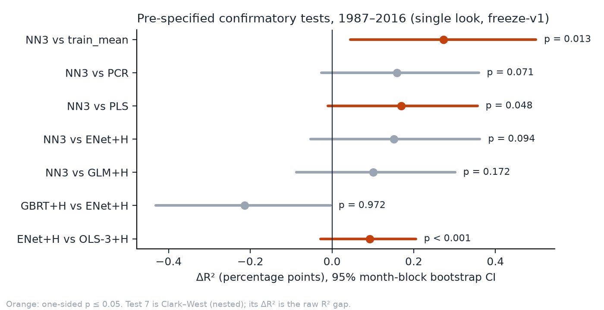
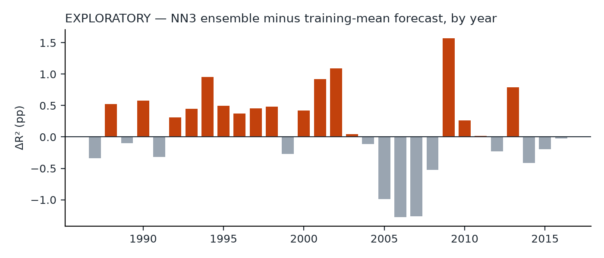

# Does machine learning still beat a constant? A pre-registered replication of Gu, Kelly & Xiu (2020), 1987–2016

Patrick Damouni · Michigan State University · October 2026
Code and full decision log: this repository (private). Test-window result: tag `result-v1`.

## The result in five lines

1. **GKX's model ranking did not reproduce.** Neural nets did not beat the penalized linear models
   at conventional significance, and gradient-boosted trees did *worse* than the elastic net
   (ΔR² −0.21 pp, bootstrap CI entirely below zero).
2. **A 5-seed NN3 ensemble beat a constant forecast** (each training window's mean return):
   ΔR² = 0.27 pp, 95% CI [0.05, 0.50], one-sided Diebold–Mariano p = 0.013. This does not survive a
   Holm correction across the seven pre-specified tests.
3. Its level of predictability, **R²_oos = 0.45%** [0.17, 0.73], is close to GKX's 0.40%.
4. That edge **needs the ensemble** (no single seed beats the constant), **comes from sorting the
   smallest stocks within each month**, and **reverses in 2005–2008** (exploratory diagnostics).
5. The pre-specified verdict rule prints **"partially replicates"**. Under the rule as it stood one
   amendment earlier, the same numbers read "does not replicate (level only)" (see §5).

## 1. Question and design

GKX (2020, *RFS*) report that neural networks and trees predict individual US stock returns better
than linear models. This project asks whether that ranking holds when the analysis is fixed before
the 1987–2016 test window is looked at, and (Phase 5, not yet run) whether it survives after
publication on a sealed 2017–2024 holdout.

- **Data.** CRSP monthly returns for every NYSE/AMEX/NASDAQ security (D020), with delisting returns
  and Shumway imputation (D019). Characteristics: GKX's own published 94-characteristic dataset
  (D022), interacted with 8 Welch–Goyal macro predictors plus 74 industry dummies, as in the paper.
  **This is a reproduction on GKX's characteristics, not on independently built data**; the
  pre-registered independent rebuild (Open Source Asset Pricing signals) has not been run.
- **Models.** 4 OLS baselines; PCR, PLS, elastic net and group-lasso splines (all with Huber loss
  where GKX use it); gradient-boosted trees and random forests; NN1–NN3, each a 5-seed ensemble.
  Walk-forward: expanding training window from 1957, 12-year validation window, annual refits.
- **Leakage controls.** The 2017+ holdout was split off and hashed at ingest and is still sealed.
  The 1987–2016 window was locked in code: models could only see it from a clean commit carrying
  the tag `freeze-v1`, once, all models together. Every run is logged with its commit and a hash
  of its predictions.
- **Pre-specification.** Pre-registration tagged 2026-10-07; 48 logged decisions; a full dry run of
  the frozen pipeline on 1975–1986 (all 18 models reproduced bit-for-bit). The test run started
  2026-10-10 23:04 and finished 2026-10-11 22:14. **These tags are local git history**; the repo got
  its first external timestamp (GitHub) on 2026-10-12, after the result.

## 2. Pre-specified result

Verdict rule (D048, fixed before the look): the headline model is NN3. "Replicates" needs NN3's
R² CI to exclude zero *and* all seven confirmatory one-sided p-values ≤ 0.05. "Partially replicates"
needs the CI *and* test 1 (NN3 vs the constant) at p ≤ 0.05.

| Model | R²_oos % [95% CI] | GKX | Top-1000 R² % (GKX) | Bottom-1000 R² % (GKX) | VW decile Sharpe [CI] |
|:--|--:|--:|--:|--:|--:|
| Training-mean constant | 0.18 [−0.03, 0.40] | – | 0.45 (–) | 0.21 (–) | – |
| OLS-3+H | 0.21 [0.02, 0.40] | 0.16 | 0.23 (0.31) | 0.22 (0.17) | 0.58 [0.20, 0.95] |
| ENet+H | 0.30 [0.09, 0.51] | 0.11 | −0.11 (0.25) | 0.46 (0.20) | 0.89 [0.50, 1.29] |
| GBRT+H | 0.09 [−0.12, 0.31] | 0.34 | −0.15 (0.52) | 0.27 (0.32) | 0.21 [−0.27, 0.93] |
| **NN3 (5 seeds)** | **0.45 [0.17, 0.73]** | 0.40 | 0.29 (0.70) | 0.84 (0.45) | 1.43 [1.06, 1.82] |

All 18 models, every test and the seed spread are in [`results/final_report.md`](results/final_report.md),
generated once by the frozen `scripts/final_report.py`. Sharpe ratios are gross of costs.

## 3. What the result rests on (exploratory)

These diagnostics were listed in D049 before any was computed, but they come after the look and
change nothing above. Details: [`results/exploratory/phase4_diagnostics.md`](results/exploratory/phase4_diagnostics.md).

- **Ensembling.** No single NN3 seed beats the constant (R² 0.06–0.31%, p 0.18–0.83); every 4-seed
  ensemble does (p ≤ 0.038). The claim is about a 5-seed ensemble, not about one network.
- **Cross-section, not timing.** Of NN3's +0.27 pp over the constant, −0.04 pp comes from monthly
  return levels and +0.31 pp from within-month cross-sectional fit (ordering and forecast scale).
  Month-level error is about 8.7% of Σr² for every model and differs by at most 0.17 pp of it.
- **Microcaps.** 74% of the return variation sits in the smallest NYSE-size quintile, where NN3
  scores 0.58%. The constant beats NN3 in quintiles 2–4; they tie in the largest.
- **A few months.** Dropping the three months that help NN3 most (Feb, Mar, Sep 2001) moves the
  test-1 p to 0.051. NN3 lost to the constant in every year 2005–2008.

## 4. What is not claimed

- Not that neural nets or trees beat linear models (§2).
- Not that "a neural net" beats a constant: one seed does not (§3).
- Not that the model works for large stocks: on the 1,000 largest, the constant wins.
- Not a replication on independent data (§1).
- Not the demeaned-target variants (`-dm`) as a finding. They train on returns net of each month's
  mean and are the strongest models (e.g. NN3-dm R² 0.66%, RF-dm 0.70%), but they were added after
  the dry run showed trees fitting month levels (D041, D043), so they are secondary by rule.
- Not that the deflated Sharpe ratios (≈ 1.0) mean much: they count 14 variants as independent and
  ignore variants abandoned during development.

## 5. Departures and amendments, all made before the look

| Change | Decision | Effect |
|:--|:--|:--|
| GKX's own characteristics instead of an independent rebuild | D022 | reproduction, not independent replication |
| Raw (unscaled) macro predictors for PCR, PLS, ENet, NNs | D040 | after dry run; standardizing destroyed ranking skill |
| Tree inputs: characteristics + industry only | D042 | deviation from GKX's full interaction set |
| `-dm` arms for trees and NNs | D041, D043 | secondary only |
| ENet+H vs OLS-3+H replaces ENet+H vs OLS-all | D045 | OLS-all cannot lose (−170% R², D033) |
| Verdict rule | D045 → D047 → D048 | see below |

The verdict label depends on which version of the rule is applied to the same numbers:

| Rule | Label |
|:--|:--|
| Pre-registration text (paper's ranking and positive R² CI) | does not replicate |
| D045 (some test rejected under Holm) | partially replicates (only via test 7, ENet+H vs OLS-3+H) |
| D047 (test 1 rejected under Holm) | does not replicate (level only) |
| **D048, in force at `freeze-v1` (test 1 at p ≤ 0.05)** | **partially replicates** |

D048 was committed at 22:32 on 2026-10-10, 32 minutes before the test run started. It fixed a defect
a reviewer found in D047 (a worse p-value could improve the label), and it was decided without
any test-window number. It also made "partially" easier to reach, and readers should weigh it that way.

## 6. Limitations

- DM p-values assume short-range dependence (5 HAC lags, 12-month blocks); the per-year chart shows
  multi-year runs, so the stated uncertainty is likely too small.
- Monthly losses are fat-tailed: OLS-all is 170 pp worse than ENet yet its DM p is only 0.045.
- Trees are single runs, so their seed sensitivity is unknown.
- OLS-all at −170% vs GKX's −3.5% is an unresolved specification gap (macro-interaction
  extrapolation, D033).
- Bottom-1000 R² is above GKX's for most models and about double for ENet+H, GLM+H and NN1–NN3; the cause (universe or return
  construction) is not established. Rows in each stock's final CRSP month hurt every model.

## 7. Next

Phase 5 opens the sealed 2017–2024 holdout once, after a decision entry (D050) fixes its tests and
is pushed for an external timestamp. Test 1 has only about 25–30% power on the 60–96 holdout months,
so a null there would say little; this will be stated before unsealing. The independent-data rebuild is deferred.

## Reproducing

`freeze-v1` holds the frozen code; `results/trials.jsonl` logs every run with commit and prediction
hash; `docs/backup_manifest.sha256` lists the hashes of the predictions and data. CRSP data are
licensed through WRDS and are not distributed; predictions can be checked against the hashes.
